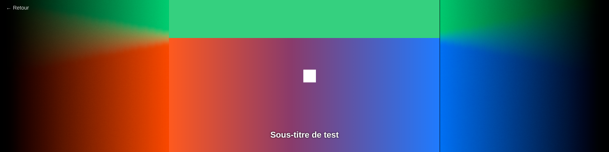
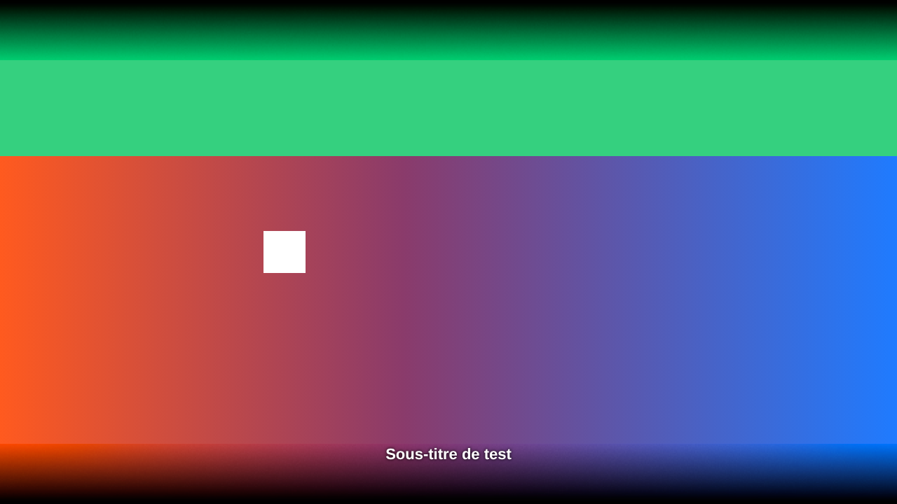
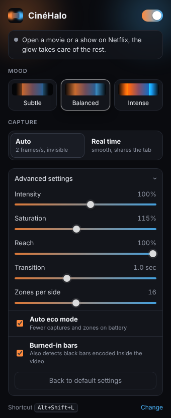

# CinéHalo

Une extension Chrome qui allume les bandes noires du lecteur Netflix avec les couleurs de l'image, un peu comme une TV à éclairage d'ambiance. Elle a été pensée d'abord pour un écran 32:9, où une série en 16:9 laisse deux énormes bandes sur les côtés, mais elle marche sur n'importe quel format.

## Le problème du DRM, et comment on le contourne

Les extensions d'ambilight pour YouTube dessinent la vidéo dans un canvas et lisent les pixels. Sur Netflix ça ne marche pas : la vidéo est chiffrée (Widevine) et Chrome renvoie du noir à la page. CinéHalo ne touche donc pas à la vidéo. Elle passe par la capture d'onglet de Chrome, une API réservée aux extensions, qui voit ce qui est affiché à l'écran.

Il y a deux façons de capturer, au choix dans le popup. La capture auto (`chrome.tabs.captureVisibleTab`) prend 2 images par seconde, c'est la limite de Chrome. Avec des transitions douces d'une seconde, on ne voit pas la différence et rien n'apparaît à l'écran. Le temps réel (`chrome.tabCapture` + un document offscreen) lit un vrai flux de l'onglet, jusqu'à 24 images par seconde. C'est plus réactif, mais Chrome affiche son indicateur de partage d'onglet.

Dans les deux cas, Chrome demande que tu aies cliqué une fois sur l'icône dans l'onglet (permission `activeTab`). C'est le prix pour ne pas réclamer l'accès à "toutes vos données sur tous les sites" à l'installation. Le raccourci **Alt+Shift+L** compte comme un clic.

Ce qui reste incertain : sur certaines configs (Windows avec certains GPU, ou Edge qui passe par du DRM matériel) la capture elle-même peut sortir noire. L'extension le détecte au bout de 20 secondes et l'indique dans le popup au lieu de rester bêtement éteinte.

## Installer et utiliser

En attendant le Web Store, ouvre `chrome://extensions`, active le mode développeur, puis "Charger l'extension non empaquetée" et choisis ce dossier. Lance un film ou une série sur Netflix, clique une fois sur l'icône CinéHalo (ou Alt+Shift+L), et la lueur arrive en fondu dans les bandes. Si tu installes l'extension alors que Netflix est déjà ouvert, recharge l'onglet.

La lueur s'allume toute seule dès qu'il y a des bandes noires assez larges autour de l'image, reste figée quand tu mets pause, et devient noire quand l'image est noire (pas de lumière "inventée"). L'extension repère aussi les bandes noires encodées directement dans la vidéo, sur les vieux films ou les docs en 4:3. Elle attend quelques secondes d'images avec du contenu avant de les éclairer, pour ne pas confondre une bande avec une scène sombre.

Le popup propose trois ambiances (Subtil, Équilibré, Intense), le choix du mode de capture, et une section repliée pour régler finement l'intensité, la saturation, la portée de la lueur dans la bande, la durée des transitions et le nombre de zones par côté. Le mode éco réduit les captures et les zones quand le portable est sur batterie.

## Comment c'est construit

Tout est en JavaScript sans dépendance ni build.

- `src/content/content.js` trouve la vidéo, calcule où est vraiment l'image (object-fit compris), décide quelles bandes éclairer et anime les couleurs.
- `src/content/glow.js` dessine chaque bande dans un tout petit canvas (48 px de profondeur) que le navigateur agrandit en lissant. La lumière se diffuse en s'éloignant de l'image, et un léger bruit en soft-light évite les escaliers de couleur dans les grands dégradés sombres.
- `src/shared/sampler.js` analyse une capture réduite : couleur moyenne de chaque zone au bord de l'image (en lumière linéaire, avec plus de poids pour les pixels saturés), détection des bandes incrustées, repère "image noire".
- `src/shared/baked.js` décide quand verrouiller une bande incrustée, l'agrandit si besoin et la relâche si l'image déborde dessus.
- `src/background.js` fait les captures auto, pilote le flux temps réel et gère le raccourci.
- `src/offscreen/` lit le flux de l'onglet en mode temps réel.

La lueur est insérée juste après l'élément `<video>`, donc au-dessus de l'image mais sous les sous-titres et les contrôles de Netflix. Si Netflix change la structure de son lecteur, c'est `findVideo()` et `stageRect()` dans `content.js` qu'il faudra regarder. Pour diagnostiquer, l'élément `
` porte l'état courant dans `data-status` et `data-baked`.

## Tests

`npm test` lance les tests unitaires de l'analyse d'image et du suivi des bandes (Node 18+, aucune dépendance).

`npm run e2e` charge l'extension dans Chromium sous Xvfb et sert une fausse page `netflix.com/watch` avec une vidéo non protégée. Il vérifie la lueur en ultrawide, la pause, les réglages en direct, les bandes incrustées en 16:9, le parcours réel sans permission large (raccourci clavier envoyé au niveau X11, il faut `python-xlib`) et le mode temps réel. Il faut Playwright installé globalement. Évidemment ça ne remplace pas un essai sur le vrai Netflix, que je n'ai pas pu faire d'ici.

## Publier sur le Chrome Web Store

`npm run zip` produit `dist/cinehalo-<version>.zip`. Le nom public évite "Netflix" et "Ambilight", qui sont deux marques déposées (Ambilight appartient à Philips). Les textes de la fiche et la justification de chaque permission sont dans [`store/STORE.md`](store/STORE.md), la politique de confidentialité dans [`PRIVACY.md`](PRIVACY.md).
